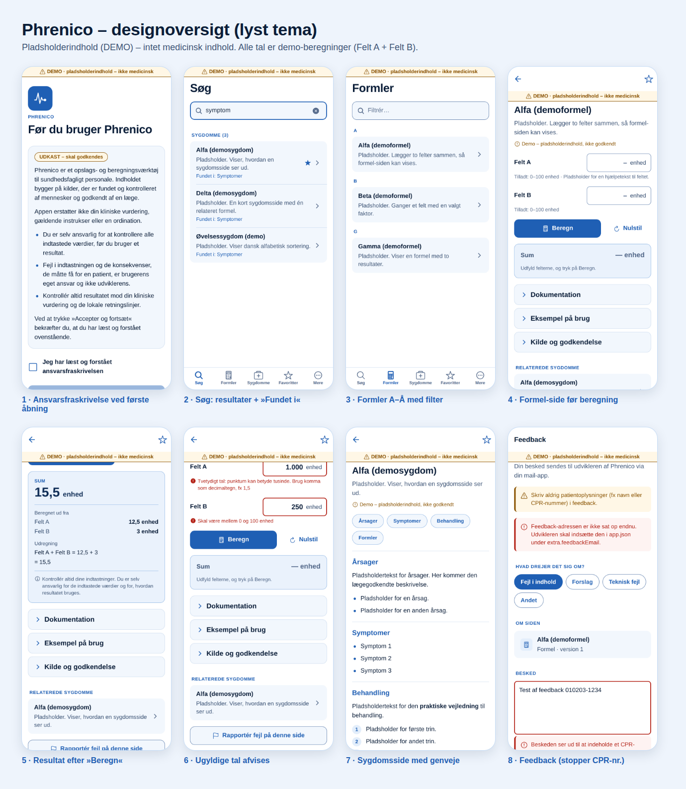
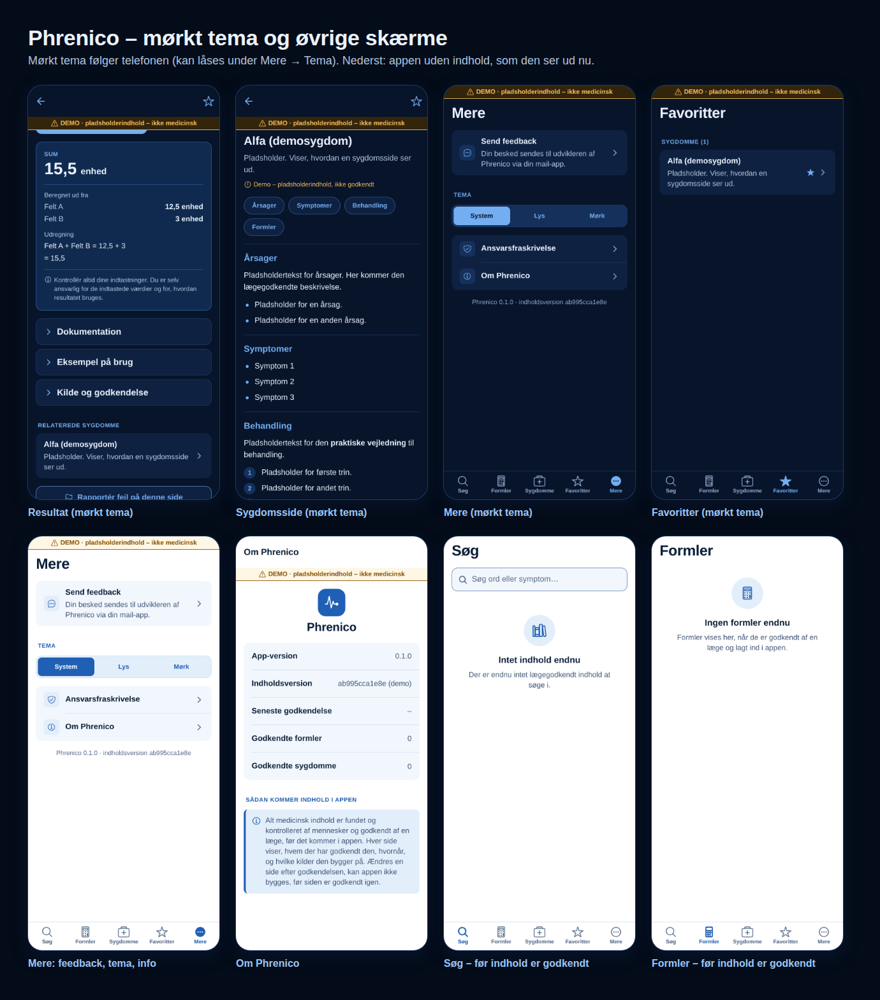

# Design

Designet bygger på ejerens beslutninger (se nederst). Alle farver, skrifter og
afstande ligger ét sted, i `src/theme/`. Skærme og komponenter bruger kun
navngivne tokens (fx `colors.primary`), aldrig farvekoder direkte. Et nyt
farvevalg kræver derfor kun ændringer i `src/theme/palette.ts` og
`src/theme/tokens.ts`.

*Skærmbillederne viser pladsholderindhold (DEMO), ikke medicinsk indhold.
De er taget fra web-forhåndsvisningen, så skriften ser en smule anderledes
ud end på en telefon.*

## Farver: hvid baggrund og en kombination af blå

| Token | Lys | Mørk | Bruges til |
| --- | --- | --- | --- |
| `background` | `#FFFFFF` | `#07142A` | Sidebaggrund |
| `surface` | `#F2F7FD` | `#0E2140` | Kort, rækker, fold-ud-bokse |
| `surfaceAlt` | `#E3EEFB` | `#15305A` | Chips, valgte elementer, ikonbobler |
| `border` | `#D3E1F2` | `#1D3A64` | Tynde skillelinjer |
| `inputBorder` | `#6A88B3` | `#5A83BA` | Kant om indtastningsfelter |
| `text` | `#0A1D38` | `#EAF2FD` | Brødtekst og titler |
| `textSecondary` | `#3F5677` | `#AFC3DF` | Resuméer, hjælpetekst |
| `textMuted` | `#54698A` | `#8FA7C9` | Pladsholdere, tilladte intervaller |
| `primary` | `#1F5FB4` | `#74AEF2` | Knapper, aktiv fane, links, overskrifter |
| `resultSurface` | `#EAF2FC` | `#102A4F` | Resultatboksen |
| `resultText` | `#0F2D56` | `#EAF2FD` | Tallet i resultatboksen |
| `danger` | `#B42318` | `#FF8C82` | Fejl i felter, fejlbeskeder |
| `warning` | `#8A5300` | `#F4BC5C` | Advarsler, demo-banner, udkast |

Rød og rav bruges kun, hvor noget skal skille sig ud fra det blå: fejl,
advarsler og demo-mærkning. Alle tekst/baggrund-par opfylder WCAG AA
(kontrast ≥ 4,5:1), og kanten om felter har ≥ 3:1.

**Mørkt tema** følger telefonens indstilling, men kan låses under
Mere → Tema (System / Lys / Mørk), fx til nattevagter.

## Typografi

Systemskriften (San Francisco på iOS, Roboto på Android). Den er den mest
læsbare og følger telefonens tekststørrelse.

| Variant | Størrelse / linje | Bruges til |
| --- | --- | --- |
| `display` | 30 / 36, fed | Titel på fanerne (Søg, Formler …) |
| `title` | 24 / 30, fed | Titel på formel- og sygdomsside |
| `heading` | 18 / 24, halvfed | Sektionsoverskrifter, fold-ud-titler |
| `body` / `bodyStrong` | 16 / 24 | Brødtekst / rækketitler |
| `callout` | 15 / 21 | Resuméer i lister |
| `caption` | 13 / 18 | Hjælpetekst, "Fundet i", godkendelseslinje |
| `overline` | 12 / 16, fed, versaler | Gruppeoverskrifter (A, B, SYGDOMME (3)) |
| `result` | 34 / 40, fed, tal med fast bredde | Resultatet |

Afstande: 2, 4, 8, 12, 16, 24, 32. Hjørner: 8, 12, 16. Alt, der kan trykkes
på, er mindst 44 × 44 punkter.

## Navigation

Bundmenu med fem faner: **Søg · Formler · Sygdomme · Favoritter · Mere**.
Formel- og sygdomssider åbnes oven på fanerne med tilbageknap ("‹ Formler")
og en stjerne øverst til højre til favoritter.

## Skærmene

**Søg.** Stort søgefelt ("Søg ord eller symptom…"). Uden søgeord vises
"Senest brugt". Resultaterne grupperes i Sygdomme og Formler, og hver række
viser, hvor ordet blev fundet ("Fundet i: Symptomer"). Søgningen finder kun
tekst og vurderer intet medicinsk.

**Formler / Sygdomme.** A–Å-liste (dansk rækkefølge: Æ, Ø, Å efter Z) med
bogstavoverskrifter og et filterfelt øverst. En stjerne på rækken viser
favoritter.

**Formel-side (alt på én side).**
1. Titel, kort beskrivelse og linjen "Godkendt af … · dato"
2. Felterne: navn til venstre, feltet med enhed til højre og det tilladte
   interval under
3. **Beregn** og **Nulstil**
4. Resultatboksen med resultat, "Beregnet ud fra" (de brugte værdier),
   "Udregning" og påmindelsen om brugerens ansvar
5. Fold-ud: Dokumentation · Eksempel på brug · Kilde og godkendelse
6. Relaterede sygdomme og "Rapportér fejl på denne side"

**Sygdomsside (én lang side).** Titel, resumé og godkendelseslinje, derefter
genvejsknapper [Årsager] [Symptomer] [Behandling] [Formler], der hopper ned til
sektionerne. Nederst kommer relaterede formler, Kilde og godkendelse, og
"Rapportér fejl".

**Favoritter.** Formler og sygdomme hver for sig, A–Å.

**Mere.** Send feedback, Tema, Ansvarsfraskrivelse, Om Phrenico.

**Feedback.** Type (Fejl i indhold / Forslag / Teknisk fejl / Andet) og
besked. Knappen åbner telefonens mail-app med side og versioner udfyldt.
Feltet advarer mod patientoplysninger og blokerer, hvis beskeden ligner et
CPR-nummer.

**Ansvarsfraskrivelse.** Skal accepteres første gang, appen åbnes, og igen
hver gang teksten ændres. Teksten er et tydeligt markeret UDKAST.

## Komponenter (`src/components/`)

`Screen`, `ScreenTitle`, `AppText`, `Icon`, `SearchField`, `ListRow`,
`SectionHeader`, `ContentList` (A–Å), `Button`, `NumberField`, `ChoiceField`,
`ResultCard`, `Collapsible`, `JumpChips`, `ApprovalLine`, `ApprovalDetails`,
`ContentBlocks`, `Notice`, `EmptyState`, `FavoriteButton`, `SegmentedControl`,
`Checkbox`, `ReportButton`, `DemoBanner`, `AppLogo` (pladsholderlogo),
`DisclaimerText`, `NotFound`.

## Beslutninger

| Spørgsmål | Valg |
| --- | --- |
| Teknologi | React Native + Expo (TypeScript), én kodebase til Android og iOS |
| Omfang nu | Skelet + motorer, uden medicinsk indhold og uden rigtige formler |
| Navigation | Bundmenu med faner |
| "Afgrænsning" | Søgning på ét ord, resultater grupperet i Sygdomme og Formler |
| Formel-side | Alt på én side |
| Sygdomsside | Én lang side med genvejsknapper |
| Farver | Hvid baggrund, resten en kombination af blå |
| Feedback | Formular → e-mail |
| Beregning | Med Beregn-knap. Resultatet forsvinder, når et felt ændres |
| Lister | Alfabetisk A–Å |
| Vejledninger | Kun på sygdomssiden (sektionen Behandling) |
| Ansvarsfraskrivelse | Skal accepteres ved første åbning og indeholder, at fejl i indtastningen og deres konsekvenser for patienten er brugerens ansvar. Påmindelsen vises også ved resultatet. |

Standardvalg, som kan ændres: dansk sprog (al tekst ligger i `src/i18n/da.ts`),
indhold indbygget i appen (virker offline), favoritter og historik gemmes kun
lokalt på telefonen, intet login, og arbejdsnavnet er Phrenico.
